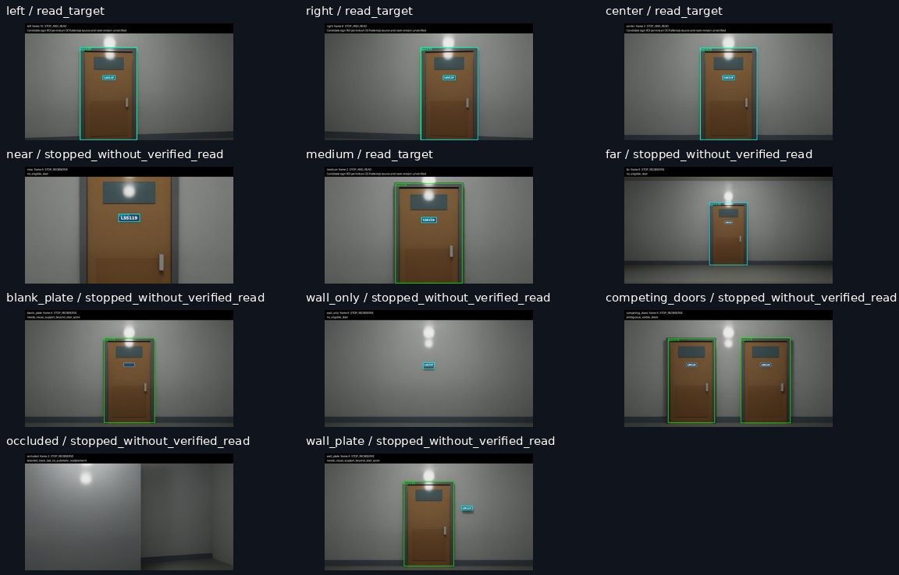

# Isaac Sim 单门反馈实验记录

2026年11月18日，在 `main` 的 `b6e1485` 基线上运行3组共33个用例、222帧真实模型推理。12像素 OCR 白边对照中的左偏、右偏和正对用例完成了图像驱动的对准、前进0.45米、停读并读对 `LSS119`。这些用例最终距离门约4.35米。中距离用例从起点直接读对门牌。


## 方法与结果

Isaac Sim 6.2 渲染教学走廊。现有 YOLOE 适配器和 RapidOCR 产生门／标牌候选及 OCR，schema3 `DoorApproachPreview` 产生建议，实验执行层按建议转动或平移相机，再渲染新图像。策略不接收门位置、房号真值、投影框或距离。场景真值用于运行后的轨迹评分。

| 用例 | 768×432 原裁剪 | 1536×864 原裁剪 | 768×432 加12px白边 |
|---|---|---|---|
| 左偏22° | 左转4次、前进一次，OCR为空 | 左转4次、停读，OCR为空 | 左转4次、前进一次、读对 |
| 右偏22° | 右转4次、前进一次，OCR为空 | 右转4次、停读，OCR为空 | 右转4次、前进一次、读对 |
| 正对，4.8m | 前进一次，OCR为空 | 直接停读、读对 | 前进一次、读对 |
| 近处，2.5m | 无合格门候选、停止 | 同左 | 同左 |
| 中距离，3.5m | 直接停读、读对 | 直接停读、读对 | 直接停读、读对 |
| 远处，6.5m | 无合格门候选、停止 | 同左 | 同左 |
| 空白门牌 | 缺少门牌视觉支持、停止 | 同左 | 同左 |
| 仅墙面及标牌 | 无合格门候选、停止 | 同左 | 同左 |
| 双门竞争 | 候选歧义、停止 | 同左 | 同左 |
| 第3帧遮挡 | 先左转2次，目标丢失后锁定停止 | 同左 | 同左 |
| 门旁墙面标牌 | 缺少门牌视觉支持、停止 | 同左 | 同左 |

原裁剪中，部分起始帧已读对房号，前进后紧裁剪却返回空 OCR。对一个18×45像素的实际 ROI 复查，原输入返回空结果，四周加12像素白边后返回 `LSS119`、confidence约0.996。这个发现促成了第三组开发对照。所有原始失败记录均保留，第三组属于已观察场景上的修改后回归。

白边只用于实验的 OCR 输入。原图、检测框、OCR 模型、图像中的门牌尺寸、跟踪和决策阈值保持原参数，策略的32×16像素停读条件继续按原框计算。完整实现与参数在[运行说明](../../../examples/isaac_single_door/README.zh-CN.md)中。

## 证据与复核

| 运行目录 | 分辨率 | OCR白边 | 推理帧数 | 结果文件 |
|---|---|---|---|---|
| `suite-01` | 768×432 | 0 | 77 | [汇总](suite-01/summary.json) · [环境与源码哈希](suite-01/manifest.json) |
| `suite-02-hires` | 1536×864 | 0 | 72 | [汇总](suite-02-hires/summary.json) · [环境与源码哈希](suite-02-hires/manifest.json) |
| `suite-03-border` | 768×432 | 12 | 73 | [汇总](suite-03-border/summary.json) · [环境与源码哈希](suite-03-border/manifest.json) |

每个用例子目录含 `events.jsonl.gz`、`trace.jsonl.gz` 和 `summary.json`。事件日志可确定性重算原策略输出，轨迹日志保留真实检测框、OCR、动作、相机前后位姿、门真值投影和 RGB SHA256。紧凑审核包可在普通 Python 环境验证。

```bash
PYTHONPATH=src python examples/isaac_single_door/verify.py \
  docs/experiments/isaac-single-door/suite-03-border --logs-only
```

完整33个用例已在远程原始目录通过策略回放、位姿转换、评分重建和 PNG 哈希检查。33段视频通过 FFmpeg 完整解码，33套 USD 重新打开并核对相机位姿和相对纹理路径。[USD核验结果](saved-scenes-audit.json)。405项离线测试通过，新增9项针对误把墙面、错误目标、弱／冲突 OCR、无关联文本或未前进轨迹计作成功的回归。



## 仍待验证

近处画面存在门体截断，近处和远处用例均未持续产生合格门候选，门旁墙面标牌不满足当前门框包含关系。这三种情况在本轮均未完成读牌。仅提高分辨率也未解决偏转视角的紧裁剪 OCR 空结果。

执行端采用运动学相机，未测机器人底盘动力学、碰撞避障、手机取流、人机反馈和端到端延迟。场景材质、尺寸和光照是受控建模条件，本轮没有 Qwen 对照。停读成功表示仿真评分中的正确读牌，主线的实体门关联、独立房号确认和 `FOUND` 仍需各自验收。

后续可由队友审查白边预处理是否应进入正式 ROI 接口，以及如何支持门旁标牌和截断门。当前 PR 提供实验入口、证据和对照结果。
