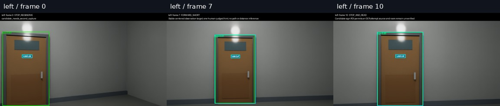

# 8GB 受限配置下的单门视觉模块实验

本 PR 的交付范围是低负载、受控场景中的视觉模块联调和失败分析。现有证据支持检测／OCR、观察建议和下一帧图像之间的数据通路，以及特定场景中的停止与读牌行为。完整单门接近、现场手持闭环和机器人执行仍待独立验收。

2026年11月18日，在 `main` 的 `b6e1485` 基线上，对同一组11个人工设计用例运行3种设置，共33次配置运行、222帧模型推理。白边对照中的左偏、右偏和正对用例各前进一次0.45米后读对 `LSS119`，最终距门约4.35米。中距离用例从3.5米起点直接读对。这些数字描述本组开发用例，场景泛化和独立成功率仍需新样本评估。

## 硬件条件与实验简化

Isaac Sim 6.2 的 x86_64 官方最低显存配置为16GB。实际运行机器使用 RTX 4060 Laptop GPU，标称8GB，`nvidia-smi` 报告8188 MiB，低于该最低配置。官方文档同时说明，低显存会限制部分教程、复杂场景和多传感器工作流。本次证据仅覆盖下表所列配置。[NVIDIA 官方硬件要求](https://docs.isaacsim.omniverse.nvidia.com/6.2.0/installation/requirements.html)

| 项目 | 本次实际条件 | 结论范围 |
|---|---|---|
| 渲染 | 无界面 `headless=True`，单GPU `RaytracedLighting` | GPU离屏渲染的小负载运行 |
| 场景 | 手工建立的局部走廊、简单几何、固定纹理和光照 | 受控视觉条件中的模块行为 |
| 相机 | 单路 RGB，768×432或1536×864，各用例依次执行 | 这两种分辨率与单相机配置 |
| 执行 | 直接修改相机位姿，每次转动4°或前进0.45m，检查固定坐标范围 | 理想、固定步长执行下的视觉反馈 |
| 感知 | YOLOE小模型、RapidOCR、预缓存检测提示词特征 | 这组感知配置的输出与故障 |
| 时间 | 逻辑采样时间为序号除以2，视频按2 FPS编码 | 离线顺序处理与展示 |

本轮记录缺少全程显存峰值、资源余量和端到端实时性能测量。8GB适用性目前只由这33次小场景运行提供证据。完整教学楼资产、多相机和同时加载大模型的资源需求仍待测量。

执行层通过相机变换直接应用建议。机器人关节和底盘动力学、碰撞避障、路径可通行性，以及人的实际动作反馈仍需单独验证。当前调用路径为 `DoorApproachPreview`，`LiveDoorApproachSession` 的现场取流、时钟和反馈验收仍待完成。



## 方法与结果

Isaac Sim 6.2 渲染教学走廊。现有 YOLOE 适配器和 RapidOCR 产生门／标牌候选及 OCR，schema3 `DoorApproachPreview` 产生建议，实验执行层按建议转动或平移相机，再渲染新图像。策略不接收门位置、房号真值、投影框或距离。场景真值用于运行后的轨迹评分。

日志中的 `success` 对应 `read_target`，表示在选定门的停读机会中读对目标编号。空间评分条件采用朝向误差与门投影框重合度，停止距离单独记录。`approach_then_read=true` 另外要求执行过前进动作。三个满足该字段的用例均只执行一次0.45米位移，门前到达距离验收仍需另设实验。

| 用例 | 768×432 原裁剪 | 1536×864 原裁剪 | 768×432 加12px白边 |
|---|---|---|---|
| 左偏22° | 左转4次、前进一次，OCR为空 | 左转4次、停读，OCR为空 | 左转4次、前进一次、读对 |
| 右偏22° | 右转4次、前进一次，OCR为空 | 右转4次、停读，OCR为空 | 右转4次、前进一次、读对 |
| 正对，4.8m | 前进一次，OCR为空 | 直接停读、读对 | 前进一次、读对 |
| 近处，2.5m | 无合格门候选、停止 | 同左 | 同左 |
| 中距离，3.5m | 直接停读、读对 | 直接停读、读对 | 直接停读、读对 |
| 远处，6.5m | 无合格门候选、停止 | 同左 | 同左 |
| 空白门牌 | 缺少门牌视觉支持、停止 | 同左 | 同左 |
| 仅墙面及标牌 | 无合格门候选、停止 | 同左 | 同左 |
| 双门竞争 | 候选歧义、停止 | 同左 | 同左 |
| 第3帧遮挡 | 先左转2次，目标丢失后锁定停止 | 同左 | 同左 |
| 门旁墙面标牌 | 缺少门牌视觉支持、停止 | 同左 | 同左 |

原裁剪中，部分起始帧已读对房号，前进后紧裁剪却返回空 OCR。对一个18×45像素的实际 ROI 复查，原输入返回空结果，四周加12像素白边后返回 `LSS119`、confidence约0.996。这个发现促成了第三组开发对照。所有原始失败记录均保留，第三组属于已观察场景上的修改后回归。

这组实验的工程价值是复现具体故障并产生可审查的处理假设。白边预处理的普适性、额外误读风险及真实门牌效果，需要未参与开发的新图像和独立标注来评价。

白边只用于实验的 OCR 输入。原图、检测框、OCR 模型、图像中的门牌尺寸、跟踪和决策阈值保持原参数，策略的32×16像素停读条件继续按原框计算。完整实现与参数在[运行说明](../../../examples/isaac_single_door/README.zh-CN.md)中。

## 证据与复核

| 运行目录 | 分辨率 | OCR白边 | 推理帧数 | 结果文件 |
|---|---|---|---|---|
| `suite-01` | 768×432 | 0 | 77 | [汇总](suite-01/summary.json) · [环境与源码哈希](suite-01/manifest.json) |
| `suite-02-hires` | 1536×864 | 0 | 72 | [汇总](suite-02-hires/summary.json) · [环境与源码哈希](suite-02-hires/manifest.json) |
| `suite-03-border` | 768×432 | 12 | 73 | [汇总](suite-03-border/summary.json) · [环境与源码哈希](suite-03-border/manifest.json) |

每个用例子目录含 `events.jsonl.gz`、`trace.jsonl.gz` 和 `summary.json`。事件日志可确定性重算原策略输出，轨迹日志保留真实检测框、OCR、动作、相机前后位姿、门真值投影和 RGB SHA256。紧凑审核包可在普通 Python 环境验证。

```bash
PYTHONPATH=src python examples/isaac_single_door/verify.py \
  docs/experiments/isaac-single-door/suite-03-border --logs-only
```

完整33次配置运行已在远程原始目录通过策略回放、位姿转换、评分重建和 PNG 哈希检查。33段视频通过 FFmpeg 完整解码，33套 USD 重新打开并核对相机位姿和相对纹理路径。[USD核验结果](saved-scenes-audit.json)。远程405项离线测试全部通过，新增9项评分回归。GitHub Python 3.11 CI为402项通过、3项因缺少FFmpeg跳过，这3项已在远程执行通过。

这些核验支持日志一致性、文件可用性和代码回归。图像真实性、场景代表性、检测准确率和导航效果需要对应的数据与评价协议。222帧来自重复场景中的连续观测，独立统计评估仍待开展。


## 仍待验证

近处画面存在门体截断，近处和远处用例均未持续产生合格门候选，门旁墙面标牌不满足当前门框包含关系。这三种情况在本轮均未完成读牌。仅提高分辨率也未解决偏转视角的紧裁剪 OCR 空结果。

执行端采用运动学相机，未测机器人底盘动力学、碰撞避障、手机取流、人机反馈和端到端延迟。场景材质、尺寸和光照是受控建模条件，本轮没有 Qwen 对照。停读成功表示仿真评分中的正确读牌，主线的实体门关联、独立房号确认和 `FOUND` 仍需各自验收。

| 项目问题 | 本轮证据 | 验收状态 |
|---|---|---|
| 感知建议能否改变后续观测 | 保存了建议、相机位移和新渲染帧 | 受控场景下已验证 |
| 紧裁剪 OCR 是否存在可复现问题 | 原裁剪与白边对照保留真实模型输出 | 故障已复现，处理方案待独立评估 |
| 歧义和丢失时的停止行为 | 双门竞争、遮挡和空白标牌用例日志 | 仅覆盖这些开发用例 |
| 完整单门对准、接近、稳定读牌 | 一次0.45m相机位移及正确读数 | 距离验收、实际执行和鲁棒性待补 |
| M3.3手持现场闭环 | 真实取流、动作反馈和端到端时延仍待采集 | 待验收 |
| Qwen／ReasonNav系统与多门寻房 | 对应模型、底层执行和对照实验仍待接入 | 待验证 |
| 8GB运行完整仿真系统 | 完整资产与模型组合的资源测量仍待开展 | 待验证 |

请队友按局部模块实验审查本 PR，重点核对上述证据范围、白边处理的评价方案和门旁标牌关联缺口。完整单门验收与原项目现场里程碑继续按各自协议推进。
