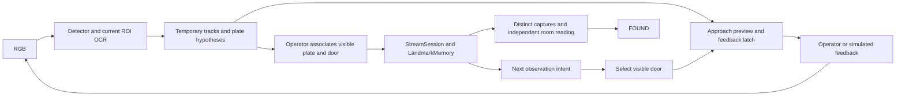

# M4 multi-door search

One episode has one target, one source clock and one in-memory M2 stream. The video CLI, Gradio service and Isaac host use the same `MultiDoorSearchSession.apply` boundary. Real RGB enters through `search_io.rgb_command`. Deterministic fixture runs supply current-frame detector/OCR events directly. No component commands a physical actuator.

## Integration audit

| Existing module | Actual API and responsibility | M4 integration |
|---|---|---|
| `rgb_perception`, `offline_perception`, `ocr` | `YOLOWorldDetector.detect(rgb)` returns scored normalized door/sign proposals. `perceive_frame(VideoFrame, DetectorSource, ocr=read_roi)` crops each current sign and records readings/errors by detection index. | One inference per frame supplies both evidence and approach. Optional timing measures the detector and all current ROIs separately. HumanBoxSource exports remain outside this route. |
| `visual_tracking` | `ConservativeTracker.update(frame_id, timestamp_s, detections)` aligns current detections in input order by class and overlap. Ambiguity or loss can allocate new temporary IDs. | The preview owns the tracker. It survives an explicitly ended approach within the episode. The binding to a physical landmark expires when a pair disappears. |
| `m1_adapter`, `m1_pipeline` | `RoomOCRSample.to_m2_event()` encodes capture and region identity. `M1Session.ingest` deduplicates and retains raw rejection information. | The upstream `CandidateEvent` retains every ROI including missing/ambiguous OCR. Only a complete, high-confidence reading on the selected, manually bound plate is submitted to M1. |
| `stream`, `memory`, `baseline` | `StreamSession.process_event` accepts the established strict observation and operator confirmation events. `LandmarkMemory` accumulates conflicts and explicit confirmations. `decide_next` implements the historical Rule. | Each session uses one corridor segment. No map or coordinates enter the policy. The current visual intent adds a suggested visible track, raw directional-board readings and unvisited visible tracks. |
| `llm_planner`, `openai_compatible` | `LLMPlanner.plan` snapshots received evidence, validates structured actions and gates privileged outcomes. The transport talks to an explicitly configured endpoint. | An optional adapter adds current visual candidates and checks an optional visible track choice. VLM RGB additionally supplies one resized JPEG. All variants retain the deterministic confirmation gate. |
| `door_approach`, `live_approach` | `DoorApproachPreview` checks current box quality, geometry, stability, plate cues and competing tracks. `LiveDoorApproachSession` uses the `VisualGuidanceController` pending-action latch. | `process_perception` consumes shared M1 output. The M4 preview opts into adjacent-wall hypotheses and bounded replenishment after acknowledged execution. Historical replay schemas retain their original behavior. |
| `apps/rgb_guidance_demo.py` | The single-door Gradio app owns its live M3 session. | `apps/multidoor_search.py` is a separate per-session app with independent visual review, physical association, execution and label controls. |
| `examples/isaac_single_door` | `scene.Corridor` authors the geometry, textures and camera. `control.move` performs bounded kinematic test motion. | The multi-door renderer reuses the scene primitives. A separate host consumes RGB and drives the episode. Only the evaluator opens the projected ground-truth file. |

## Evidence and identity

`search_evidence.CandidateEvent` carries the session/frame identifiers, decision clock time, optional original integer PTS and time base, image dimensions, class, normalized xyxy, detector score, temporary track, OCR readings and errors, association status/source, door track, physical ID, landmark ID, source context and provenance.

A sign is a hypothesis when one door contains it or its jamb is close at plaque height. Low-confidence rivals participate in ownership ambiguity. A door with competing plates, a sign between plausible owners, or a lost pair cannot acquire a binding. Two consecutive eligible captures of the same sign/door geometry permit operator binding. The operator supplies a separate physical ID and explicitly reuses it on a verified revisit. Physical IDs are local to an episode. The selected plate must have one complete OCR identity and confidence of at least 0.8 to enter M2. Repeated submissions of one region/frame stay one observation. Conflicting labels across frames remain votes in the same landmark. Directional signs remain raw planning cues.

`apply` handles frames and human commands. Each output records the state transitions, active lock, recommendation, approach advice, geometry checks, current evidence, strict observations, memory and pending action ID. Inputs reference the displayed frame or action ID. Emergency STOP is session-wide. Reset creates a new session with a new log.

The live adapter prepares perception and planning on a draft of the committed session. Publication requires the same session generation. STOP, timeout and feedback invalidate older drafts without waiting for inference or the JSONL writer. The browser renders one versioned packet for the overlay and advice and ignores late packets from a stopped or replaced session. The server uses monotonic time to revoke pending advice after six seconds or two seconds without a usable RGB update. Both deadlines are independent of camera callbacks.

Camera callbacks commit observations. A separate 250 ms browser poll publishes the current action lease and uses the browser's request-start timestamp to translate the remaining server durations into local deadlines. Polling preserves the earliest browser estimate of the fixed action deadline. A new RGB observation may refresh only the RGB watchdog. The pending lease retains the action and ID if a poll first observes it after another frame has entered `WAIT_EXECUTION`. Feedback must still match the current session and the valid server lease.

## Approach and confirmation

- Initial automatic acquisition needs two captures with one eligible door. The operator can select a current track explicitly. After loss, release the latched approach, get new RGB and select again. Selection, visual target confirmation and physical binding have separate events.
- `ALIGN`, `APPROACH` and `READ_SIGN` express M3 decisions. A forward hint needs three stable centered captures and a qualifying sign cue or visual confirmation. M4 permits at most three forward hints per temporary track and 24 movement suggestions in the episode. A safe completion can rearm one forward hint and clears stability streaks. Turns require current unambiguous, stable geometry. Every movement gets a session-unique pending action ID.
- Feedback is explicit. A refused/unsafe action, stale frame or emergency stop latches the session. A lost selected track with no pending motion enters `REOBSERVE`; unresolved execution at loss stops the session. The operator advances between doors with `next`.
- `UPDATE_MEMORY` and `PLAN_NEXT` can occur within one frame. `VERIFY_TARGET` additionally requires consistent target readings from at least two distinct captures in the current reliable door–plate binding. The M2 Rule continues to provide global search suggestions independently of this verification gate. An independent operator enters the actual number. Only an M2 operator confirmation yielding `FOUND` terminates successfully. All advice carries `motion_authorized=false`.

## Limits

Temporary 2-D overlap cannot ensure physical identity under an indistinguishable door swap. An operator must recognize revisits and assign stable physical IDs. The geometry thresholds, single-corridor assumption and model prompts have no multi-site calibration. Direction boards can justify another observation but cannot establish a route. The system has no depth, collision detection, mapping, path clearance or physical execution verification. A slow inference path may reach the freshness limit and stop.
